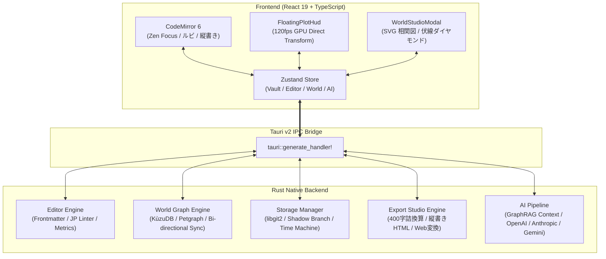

<div align="center">

# ✒️ NovelStudio
### 思考の速度で、物語を紡ぐ。
*AIと知識グラフ（GraphRAG）が並走する、Tauri v2 / Rust ネイティブ文芸スタジオ*

[](https://github.com/Yamato-JARVIS01/novel-studio/releases/latest)
[](https://opensource.org/licenses/MIT)
[](https://v2.tauri.app/)
[](https://www.rust-lang.org/)
[](https://react.dev/)
[](https://yamato-jarvis01.github.io/novel-studio/)

<br />

**[🌐 インタラクティブ・ライブ体験（Webブラウザで今すぐ試す）](https://yamato-jarvis01.github.io/novel-studio/)**  
**[📥 最新リリースをダウンロード (macOS / Windows / Linux)](https://github.com/Yamato-JARVIS01/novel-studio/releases/latest)**

<br />

---

### English Summary
**NovelStudio** is a next-generation, local-first integrated writing environment (IDE) for novelists and story architects. Powered by **Tauri v2, Rust, and React 19**, it seamlessly integrates an embedded graph database (**KùzuDB**) with bidirectional **GraphRAG consistency checking**, a 120fps GPU-accelerated floating Todo plot HUD, real-time Japanese vertical typesetting with ruby text, automatic shadow git versioning, and one-click contest/web-novel formatting. All your data stays private and offline on your machine.

---

</div>

<br />

## 💡 Core Philosophy（3つの設計思想）

### 1. ⚡ Zero-Latency Typing（打鍵遅延ゼロと完全な没入）
AST構文解析・文字数や原稿用紙換算枚数の算出・ローカルGit管理・グラフ探索などの重い処理は、すべてRustバックエンドの非同期ワーカー（`tokio`）へ完全オフロード。数万〜数十万字に及ぶ長編小説でも、キー入力遅延は理論値ゼロ。文字入力中および日本語IMEの変換中はサイドバーやツールバーが自動で完全隠蔽され、次の文章を考えて手を止めている間もノイズが一切視界に入らない**「Zen Focus」**を徹底しています。

### 2. 🕸️ Bi-directional Auto-GraphRAG（双方向グラフDBと自律設定同期）
設定ノートや原稿本文を書き進めるだけで、裏側で人物相関・舞台階層・時系列変化・色分けされた伏線ダイヤモンド（`ノード1 ➔ ◆伏線 ➔ ノード2`）が自動で構造化されます。AI推敲時にはグラフDBから登場人物の口調・一人称・設定関係性を動的に注入し、物語の矛盾や一人称のブレをピンポイントで検知・提案します。

### 3. ☁️ Invisible Git & Zero-Touch Sync（不可視のセーフティネット）
「Commit」「Branch」「Merge」「YAML Frontmatter」といった開発者用語を作家向けUIから完全隠蔽。文字を削りすぎてもスライダー1つで過去の執筆スナップショットを秒単位で復元できる**「執筆タイムマシン」**を搭載。GitHub、Google Drive、iCloud Drive への全自動バックアップにも対応し、不慮のクラッシュやデータ消失の不安をゼロにします。

<br />

---

## ✨ Key Features（主要機能）

### ✒️ Zen Focus ＆ 縦書き・ルビライブ組版
- **CodeMirror 6 独自構文拡張**: `｜親文字《ルビ》` や `《《傍点》》` を執筆画面上でリアルタイムにインライン描画。
- **ワンクリック縦書きプレビュー**: 執筆エディタと原稿用紙風の縦書き組版ビュー（右から左への流し込み）を瞬時に切り替え可能。
- **IME変換中ロック**: 日本語入力中・変換中・思考中に両端パネルを自動遮断し、マウスを画面端（12px以内）に近づけた時や `Cmd+B` / `Esc` のみ滑らかにパネルが復帰。

### 🧭 GPU Direct 120fps フローティング筋書きHUD
- **完全吸い付きドラッグ移動**: Reactの再レンダリングを完全にバイパスし、GPUコンポジットレイヤー（`translate3d` + `PointerCapture`）で画面内の好きな座標へ120fpsで滑らかに移動。
- **プロットTodoチェックリスト**: エピソードのあらすじを対話的なTodoリスト（`[ ]` / `[x]`）として管理。チェックを入れると上部の達成率プログレスバーがリアルタイムに伸縮し、Markdownフロントマターと双方向同期。
- **起承転結AIビート展開 ＆ Inline Diff加筆**: 全体プロットと話筋書きから具体的なシーン展開ビートを自動生成し、現在の原稿の続きを下書きしてInline Diff（採用/却下）へ直接流し込み可能。

### 🌐 世界観・相関図スタジオ（時系列・場所階層・伏線中継）
- **アバター画像 ＆ カード別長文ノート**: 登場人物や舞台ごとにアイコン画像をアップロード可能。何千文字でも書き込めるMarkdown設定ノートをカード内に直接統合。
- **舞台・場所レイヤー（下層ステージ枠）**: 相関図キャンバスの下部に場所専用ゾーンを配置。人物と舞台の階層関係が一目瞭然に。
- **時系列（フェーズ/話数）ページ切替**: 「全編」「第1話」「第2話」などのフェーズ切り替えで、物語の進行に応じた相関図と伏線配置を切り替え表示。
- **色分け伏線ダイヤモンドノード**: 伏線はダイヤモンド型（◇）で描画され、固有カラー（ローズ・シアン・パープル等）のハイライト矢印で中継リレーションを直感的に可視化。全ノードのマウスドラッグ自由配置と座標自動永続化に対応。

### 📤 公募規定・Web小説サイト一括エクスポーター
- **公募提出用・統合原稿（`.txt` & 印刷/PDF対応 `.html`）**:
  - 全エピソードの自動結合・Frontmatter完全除去。
  - 扉ページ自動生成（作品タイトル、全体あらすじ、総文字数、400字詰原稿用紙換算枚数、20×20 / 40×40公募規定枚数）。
  - 美しい明朝体縦書き（`writing-mode: vertical-rl`）、ルビ（`<ruby>`）、傍点、章ごとの自動改ページに対応。
- **Web小説サイト別・記法一括変換出力**:
  - **カクヨム形式**: `｜親文字《ルビ》` / `《《傍点》》`
  - **小説家になろう形式**: `親文字(ルビ)` / `《《傍点》》`（二重置換防止パーサー搭載）
  - **青空文庫形式**: `｜親文字《ルビ》`
  - **プレーンテキスト形式**: 記号を全除去したピュアテキスト出力。
  - ワンクリッククリップボードコピー＆ファイル書き出し。

<br />

---

## 📥 Installation（インストール手順）

NovelStudio はデスクトップアプリ（macOS / Windows / Linux）として配布されています。

### 1. 最新バイナリのダウンロード
**[GitHub Releases ページ](https://github.com/Yamato-JARVIS01/novel-studio/releases/latest)** より、お使いのOSに合ったインストーラーをダウンロードしてください。

| プラットフォーム | パッケージ形式 |
| :--- | :--- |
| **macOS (Apple Silicon / Intel)** | `.dmg` |
| **Windows (64-bit)** | `.msi` または `.exe` |
| **Linux (Universal)** | `.AppImage` または `.deb` |

> [!NOTE]
> **macOS で「開発元が未確認のため開けません」と表示される場合**  
> オープンソース個人ビルドのため、Apple公認デベロッパー署名の警告が出ることがあります。ターミナルを開き、以下のコマンドを1行実行することでGatekeeperの制限を解除できます：
> ```bash
> xattr -cr /Applications/NovelStudio.app
> ```

<br />

---

## 🏗️ System Architecture & Tech Stack（技術アーキテクチャ）

NovelStudio は、フロントエンドの豊かな表現力と、Rustネイティブの高い計算性能・安全性を最適に融合させたアーキテクチャを採用しています。



### 技術スタック
- **Desktop Runtime**: [Tauri v2](https://v2.tauri.app/) (Rust 2021)
- **Frontend Core**: [React 19](https://react.dev/), [TypeScript](https://www.typescriptlang.org/), [Vite 6](https://vitejs.dev/)
- **Styling**: [Tailwind CSS v3](https://tailwindcss.com/), Lucide Icons
- **State Management**: [Zustand v5](https://github.com/pmndrs/zustand)
- **Editor Core**: [CodeMirror 6](https://codemirror.net/) (カスタムルビデコレーション, ドキュメント変更リスナー)
- **Graph Engine**: [Kùzu](https://kuzudb.com/), [petgraph](https://github.com/petgraph/petgraph)
- **Version Control**: [git2 (libgit2)](https://github.com/rust-lang/git2-rs)
- **CI / CD**: GitHub Actions (`deploy-pages`, `tauri-action`)

<br />

---

## 🛠️ Development & Build（開発・ビルド手順）

開発に参加する場合、またはソースコードから手動でビルドする手順は以下の通りです。

### 必要な前提環境
- **Node.js**: v20 以降
- **Rust**: 1.78 以降（`rustup` 推奨）
- macOS / Linux の場合は各プラットフォームのビルドツール（Cコンパイラ等）

### 開発サーバの起動
```bash
# 1. リポジトリのクローン
git clone https://github.com/Yamato-JARVIS01/novel-studio.git
cd novel-studio

# 2. 依存パッケージのインストール
npm install

# 3. デスクトップアプリのローカル開発起動
npm run tauri dev
```

### 静的サイト（GitHub Pages LP & Live Demo）のビルド
```bash
# GitHub Pages 用の静的サイトを dist-pages/ に出力
npm run build:pages
```

### デスクトップアプリのプロダクションビルド
```bash
# 各OS向けネイティブインストーラーをビルド
npm run tauri build
```

### テストの実行
```bash
# Rust バックエンドのユニットテスト（19テスト全件実行）
cd src-tauri && cargo test
```

<br />

---

## 📄 License

NovelStudio は **[MIT License](https://opensource.org/licenses/MIT)** のもとで公開されているオープンソースソフトウェアです。  
商用・非商用を問わず、どなたでも自由にご利用・改変・再配布いただけます。

Copyright (c) 2026 Yamato Asamiya
